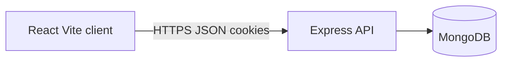
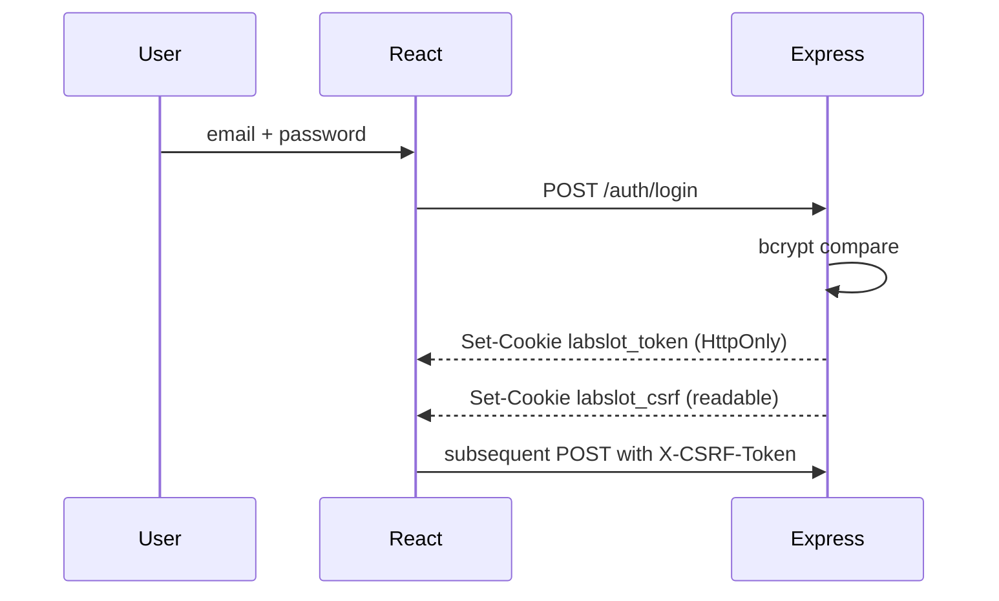
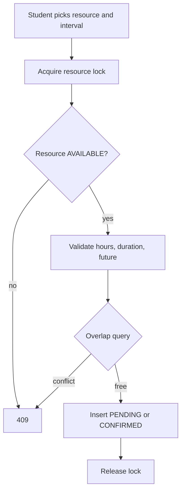

# Architecture

## High-level architecture

The client lives in `client/`. The API lives in `server/`. They communicate over REST under `/api/v1`. In development Vite proxies `/api` to port `5000`.

## Component responsibilities

| Layer | Location | Responsibility |
| --- | --- | --- |
| Pages | `client/src/pages` | Route-level screens |
| Components | `client/src/components` | Cards, tables, dialogs, badges |
| Auth context | `client/src/context` | Session user, login/logout |
| API client | `client/src/api/client.js` | Axios, CSRF header, credentials |
| Routes | `server/src/routes` | HTTP mapping |
| Controllers | `server/src/controllers` | Request/response mapping |
| Services | `server/src/services` | Business rules, especially booking |
| Models | `server/src/models` | Mongoose schemas |
| Middleware | `server/src/middleware` | Auth, roles, CSRF, errors |

## Request lifecycle

1. Helmet, CORS, JSON body parser, cookies, rate limiter.
2. CSRF check for unsafe methods (except login/register).
3. Route validators (`express-validator`).
4. `authenticate` reads the HttpOnly JWT cookie.
5. `authorize('ADMIN')` when required.
6. Controller calls a service.
7. Central `errorHandler` maps `ApiError`, duplicate keys, and CastError.

## Authentication flow

Registration always stores `role: STUDENT`. Submitting `role: ADMIN` is rejected by validation.

**Why cookies instead of localStorage?** A stored XSS payload cannot read an HttpOnly cookie. The readable CSRF cookie is a double-submit token: a cross-site form cannot read it, so it cannot forge the matching header. Trade-off: CSRF handling is required; bearer tokens in localStorage would skip CSRF but would be easier to steal via XSS.

## Booking workflow

Default `REQUIRE_BOOKING_APPROVAL=false` writes `CONFIRMED`. If enabled, `PENDING` still occupies the slot (`ACTIVE_BOOKING_STATUSES`).

Intervals are half-open: `existing.start < requested.end AND existing.end > requested.start`. A booking ending at 11:00 and another starting at 11:00 do not overlap.

## Conflict prevention and concurrency

A MongoDB query alone is not enough under two parallel HTTP requests: both can see “free” and both can insert.

LabSlot serializes writers per resource:

1. `findOneAndUpdate` sets `bookingLockUntil` only if the lock is free or expired.
2. The winner re-reads resource status, runs the overlap query, then inserts.
3. The lock is cleared in `finally`. Failed acquirers retry, then return `429`.

This works on a **standalone** MongoDB (no replica set required). Multi-document transactions would additionally need a replica set or Atlas; they are documented as a future hardening option, not a silent claim.

Cancelled and rejected bookings are excluded from overlap checks.

## Important technical decisions

- **One document per bookable unit** rather than capacity counters, so overlap is a boolean.
- **Bookings are a separate collection** so history can grow without bloating resource documents.
- **Soft deactivate** (`DEACTIVATED`) instead of `deleteOne` on resources with history.
- **Service layer** owns status transitions so controllers stay thin.
