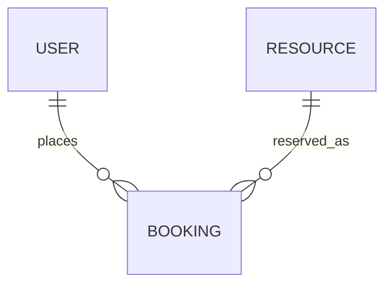
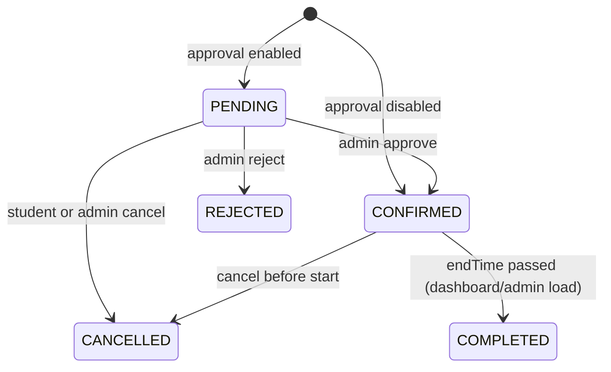

# Database schema

Collections: `users`, `resources`, `bookings`.

## users

| Field | Type | Notes |
| --- | --- | --- |
| name | string | required |
| email | string | unique, lowercase |
| passwordHash | string | bcrypt, `select: false` |
| role | enum | `STUDENT`, `ADMIN` |
| status | enum | `ACTIVE`, `DISABLED` |
| department | string | optional |
| timestamps | date | createdAt, updatedAt |

## resources

| Field | Type | Notes |
| --- | --- | --- |
| name | string | |
| resourceCode | string | unique, uppercase |
| description | string | |
| category | enum | WORKSTATION, COMPUTER, ELECTRONIC_EQUIPMENT, LABORATORY_INSTRUMENT |
| location | string | |
| specifications | string | |
| imageUrl | string | optional; UI also uses a colour block fallback |
| status | enum | AVAILABLE, MAINTENANCE, DEACTIVATED |
| bookingConfig | object | durations, advance window, hours, slot interval, cancel cutoff |
| bookingLockUntil / bookingLockOwner | date / string | concurrency mutex, not returned in public JSON |

Indexes: unique `resourceCode`; `{ category, status }`; `location`; text on name/code/description.

## bookings

| Field | Type | Notes |
| --- | --- | --- |
| bookingReference | string | unique `LS-YYYYMMDD-XXXXXX` |
| userId | ObjectId | ref User |
| resourceId | ObjectId | ref Resource |
| startTime / endTime | date | half-open interval |
| purpose | string | |
| status | enum | PENDING, CONFIRMED, REJECTED, CANCELLED, COMPLETED |
| cancellationReason | string | |
| cancelledBy | ObjectId | |
| reviewedBy / reviewedAt / reviewNote | | admin decision |

Indexes: unique `bookingReference`; `{ resourceId, startTime, endTime }`; `{ userId, createdAt }`; `{ status, startTime }`.

## Relationships



Bookings are **not** embedded in resources.

## Sample documents

User (public shape):

```json
{
  "name": "Demo Student",
  "email": "student@labslot.local",
  "role": "STUDENT",
  "status": "ACTIVE",
  "department": "Computer Science"
}
```

Booking:

```json
{
  "bookingReference": "LS-20261020-A1B2C3",
  "status": "CONFIRMED",
  "purpose": "Digital lab experiment",
  "startTime": "2026-10-20T10:00:00.000Z",
  "endTime": "2026-10-20T11:00:00.000Z"
}
```

## Status transitions



Rejected and cancelled slots become free. Maintenance on a resource blocks **new** bookings; existing rows are left in place.
